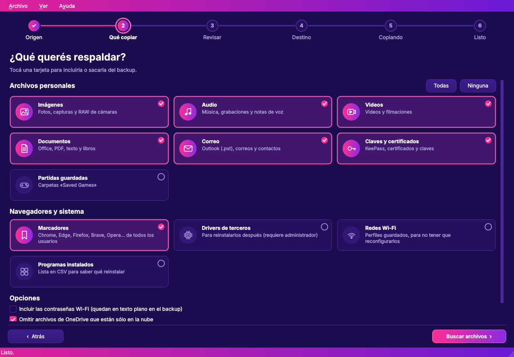

# BackupTool

Aplicación de escritorio para Windows (Python + PySide6) que busca y respalda en un disco externo o pendrive lo importante de una PC:

- **Archivos personales**: imágenes, audio, videos, documentos, correo (.pst, .eml…), claves y certificados (KeePass, .pfx…) y partidas guardadas de juegos.
- **Marcadores** de Chrome, Edge, Brave, Vivaldi, Opera y Firefox, de todos los usuarios. Se copia el archivo original y además se exporta a `marcadores.html`, que cualquier navegador puede importar.
- **Drivers de terceros**, exportados con `pnputil`.
- **Perfiles Wi-Fi** y **lista de programas instalados**, para saber qué reinstalar.

Los resultados se muestran en un explorador agrupado por **categoría → extensión**, con filtro de texto, ordenamiento por columna, vista previa de imágenes y casillas para elegir qué copiar.



## Temas

En **Ver → Tema** se elige entre *Según Windows*, *Claro*, *Oscuro*, *Medianoche*, *Arena*, *Neón*, *Cristal* y *Aero*. La elección se recuerda para la próxima vez.

*Neón*, *Cristal* y *Aero* son temas completos: estilizan con degradés todos los widgets (botones, barras de progreso, menús, combos, spinbox, encabezados, scrollbars, pestañas y barra de estado).

Para agregar un tema nuevo alcanza con sumar una entrada a `THEMES` en `backuptool/ui/themes.py`. Con `rich=True` y los campos `grad`, `bar_grad`, `chrome_grad`, `glow`, etc. se genera la hoja de estilos completa.

## Requisitos

- Windows 10 u 11
- Python 3.10 o superior

```bat
pip install -r requirements.txt
python main.py
```

## Permisos de administrador

La búsqueda y la copia de archivos funcionan como usuario común. Para exportar **drivers** y las **contraseñas Wi-Fi** hace falta ejecutar la app como administrador. La app avisa con una franja amarilla y tiene un botón para reiniciarse con permisos elevados.

## Generar el .exe

```bat
build.bat
```

Genera `dist\BackupTool\BackupTool.exe` con PyInstaller. El ejecutable pide permisos de administrador al abrirse (`--uac-admin`).

## Cómo se usa

La app es un asistente de seis pasos, pensado para respaldar los datos antes de reinstalar Windows. La barra de pasos de arriba permite volver a uno anterior.

1. **Origen**: por defecto se recorre `C:\Users` (los perfiles de usuario). También se pueden tildar otras unidades o agregar cualquier carpeta; para un disco entero, agregar su raíz (`D:\`).
2. **Qué copiar**: se eligen las tarjetas (imágenes, documentos, marcadores, drivers, redes Wi-Fi, lista de programas…) y se presiona **Buscar archivos**.
3. **Revisar**: los resultados aparecen en el explorador mientras se recorre el disco. Se desmarca lo que no se quiera copiar; con un filtro escrito, *Marcar/Desmarcar visibles* actúa sólo sobre lo que se ve. Doble clic abre el archivo; clic derecho permite **Mostrar en el Explorador**.
4. **Destino**: se elige la unidad (los pendrives aparecen primero) o una carpeta. La app muestra el espacio libre y avisa si no alcanza, si el destino es FAT32 (no admite archivos de 4 GB o más) o si está en el disco del sistema, que se borra al reinstalar.
5. **Copiando**: progreso, velocidad y tiempo restante. Se puede cancelar y retomar después con el mismo nombre.
6. **Listo**: resumen con lo copiado, los errores y un botón para abrir la carpeta del backup.

Si se cambia el origen o lo que se busca después de una búsqueda, hay que volver a buscar antes de seguir.

### Qué se excluye

`AppData`, la Papelera, `System Volume Information` y carpetas de desarrollo como `node_modules`, `.git` o `venv` se excluyen en cualquier nivel. Las carpetas de sistema (`Windows`, `Program Files`, `ProgramData`, `Recovery`…) sólo se excluyen en la raíz de cada unidad, para no perder por ejemplo una carpeta `Documentos\Windows`. La lista se puede editar con **Carpetas excluidas…**.

AppData se excluye porque está llena de cachés. Los marcadores de los navegadores, que viven ahí, se buscan aparte por su ruta conocida. También se saltean las carpetas de backups anteriores hechos con la app.

## Estructura del backup

```
Backup_<PC>_<fecha>/
├── Imágenes/C/Users/chris/Pictures/...   ← se respeta la ruta original
├── Audio/ ...  Videos/ ...  Documentos/ ...
├── Marcadores/<navegador>/<usuario>/<perfil>/marcadores.html
├── Drivers/oemNN/ ... + drivers.csv + LEEME.txt
├── Sistema/WiFi/*.xml + Sistema/programas_instalados.csv
├── manifiesto.csv   ← origen, destino, tamaño y estado de cada elemento
├── errores.log      ← sólo si hubo errores
└── LEEME.txt        ← resumen
```

Si se repite el backup con **el mismo nombre** en el mismo destino, los archivos que ya están (con igual tamaño y fecha) se saltean. Así se puede retomar un backup cortado o actualizar uno anterior.

## Restaurar

| Qué | Cómo |
|---|---|
| Archivos | Copiarlos desde la carpeta de su categoría |
| Marcadores | En el navegador: *Importar marcadores* → `marcadores.html` |
| Drivers | Consola como administrador en `Drivers\`: `pnputil /add-driver "*.inf" /subdirs /install` |
| Wi-Fi | `netsh wlan add profile filename="archivo.xml" user=all` |

## Estructura del código

```
main.py                     punto de entrada
backuptool/core/            lógica, sin dependencias de Qt (se prueba sin interfaz)
    categories.py           categorías, extensiones y exclusiones
    scanner.py              recorrido con os.scandir (pila, sin recursión, cancelable)
    browsers.py             lectura de marcadores Chromium/Firefox y exportación HTML
    drivers.py              listado de oem*.inf y exportación con pnputil
    extras.py               perfiles Wi-Fi y programas instalados (registro)
    copier.py               copia por bloques con progreso, reanudación, verificación SHA-256
    winutils.py             unidades, permisos, rutas largas, comandos de consola
backuptool/ui/
    main_window.py          ventana principal: asistente de 6 pasos
    widgets.py              barra de pasos, tarjetas de opción y de resultado, barra de espacio
    icons.py                íconos dibujados con QPainter en el color del tema
    file_model.py           modelo de árbol propio (QAbstractItemModel) + proxy de filtro
    workers.py              búsqueda y copia en QThread
    themes.py               temas (paleta + hoja de estilos) e ícono
backuptool/resources/       icon.png e icon.ico
tools/make_icon.py          regenera el ícono (dibujado con QPainter; el .ico usa Pillow)
tests/                      pytest (núcleo + prueba de humo de la interfaz)
```

Para correr las pruebas:

```bat
pip install pytest
python -m pytest
```

## Limitaciones conocidas

- Un archivo abierto en otro programa (por ejemplo un `.pst` con Outlook abierto) puede fallar; queda registrado en `errores.log`. Conviene cerrar Outlook antes del backup.
- Los archivos de OneDrive que están sólo en la nube se omiten (opción configurable), porque leerlos obligaría a descargarlos.
- No respalda perfiles completos de Thunderbird, configuraciones de programas ni el registro de Windows.
- Para ver los perfiles de otros usuarios de la PC hay que ejecutar como administrador.

## Licencia

MIT — ver [LICENSE](LICENSE).
